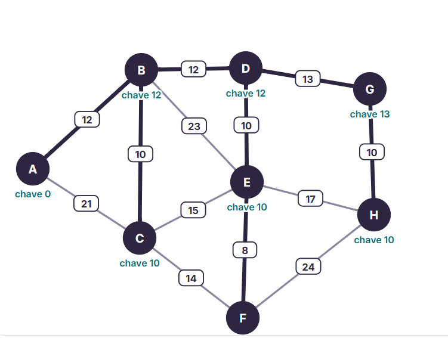
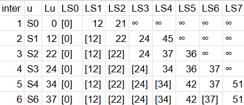
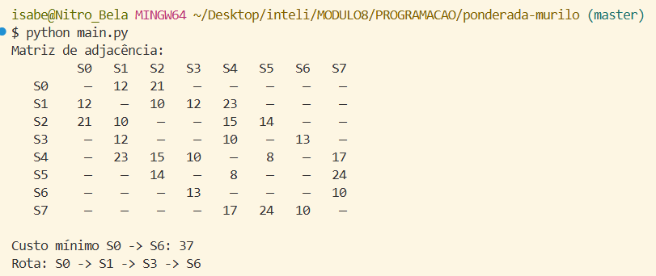

# Ponderada Murilo — Grafos (Smart Grid)

## Etapa 1

#### 1. Tabela de pesos do RA
RA: 510267 → D1=5, D2=1, D3=0, D4=2, D5=6, D6=7.
Destino -> S6

| Ramal | Aresta | Fórmula | Cálculo | w |
|---|---|---|---|---|
| e1 | (S0,S1) | 10 + (D6 mod 5) | 10 + (7 mod 5) | 12 |
| e2 | (S0,S2) | 15 + (D5 mod 7) | 15 + (6 mod 7) | 21 |
| e3 | (S1,S2) | 8 + (D4 mod 4) | 8 + (2 mod 4) | 10 |
| e4 | (S1,S3) | 12 + (D3 mod 6) | 12 + (0 mod 6) | 12 |
| e5 | (S2,S4) | 14 + (D2 mod 5) | 14 + (1 mod 5) | 15 |
| e6 | (S2,S5) | 9 + (D1 mod 6) | 9 + (5 mod 6) | 14 |
| e7 | (S3,S4) | 7 + ((D5+D6) mod 5) | 7 + (13 mod 5) | 10 |
| e8 | (S3,S6) | 11 + ((D4+D5) mod 6) | 11 + (8 mod 6) | 13 |
| e9 | (S4,S5) | 6 + ((D3+D4) mod 4) | 6 + (2 mod 4) | 8 |
| e10 | (S4,S7) | 16 + ((D2+D3) mod 7) | 16 + (1 mod 7) | 17 |
| e11 | (S5,S7) | 18 + ((D1+D2) mod 8) | 18 + (6 mod 8) | 24 |
| e12 | (S6,S7) | 9 + ((D5+D1) mod 5) | 9 + (11 mod 5) | 10 |
| e13 | (S1,S4) | 20 + (D6 mod 4) | 20 + (7 mod 4) | 23 |

#### 2. Diagrama topológico

#### 3. Matriz de pesos 8×8
|  |S0|S1|S2|S3|S4|S5|S6|S7|
|--|--|--|--|--|--|--|--|--|
|S0|--|12|21|--|--|--|--|--|
|S1|12|--|10|12|23|--|--|--|
|S2|21|10|--|--|15|14|--|--|
|S3|--|12|--|--|10|--|13|--|
|S4|--|23|15|10|--|8|--|17|
|S5|--|--|14|--|8|--|--|24|
|S6|--|--|--|13|--|--|--|10|
|S7|--|--|--|--|17|24|10|--|

#### 4. Simetria e esparsidade
- Simetria: o grafo é simétrico, característico de um grafo não orientado M[S0][S1] = M[S1][S0]
- Esparcidade: o grafo é esparso com bastante nulos. 

## Etapa 2 — Teste de mesa de Dijkstra

## Etapa 3 — Implementação

#### 1, 2 e 3
Em main.py
Terminal:

#### 4. Confronto código × mesa
O código retorna custo mínimo de 37 km e rota S0 → S1 → S3 → S6, os mesmos valores que obtive no teste de mesa.

## Etapa 4

#### 1
- Distância total mínima: 37 km
- Sequência: S0 → S1 → S3 → S6
- Ordem cronológica de fechamento: S0 → S1 → S2 → S3 → S4 → S5 → S6

#### 2 — Queda do ramal
A rota ótima não utiliza e5, então a rota continua S0 → S1 → S3 → S6 com 37 km. 

#### 3 — Prim × Dijkstra
- MST (Prim): 75 km.
- Dijkstra: a soma das distâncias mínimas a partir de S0 é de 210 km e a união das rotas radiais custa 92 km.
- O Dijkstra tem como objetivo encontrar o caminho mais barato de um ponto X até ponto um Y, sem se preocupar com o custo total da árvore. O Prim , no entanto, gera a mínima árvore, focando no menor peso geral conectando (mesmo que indiretamente) todos os vértices do grafo. O que os diferência são os objetivos e seu uso prático.